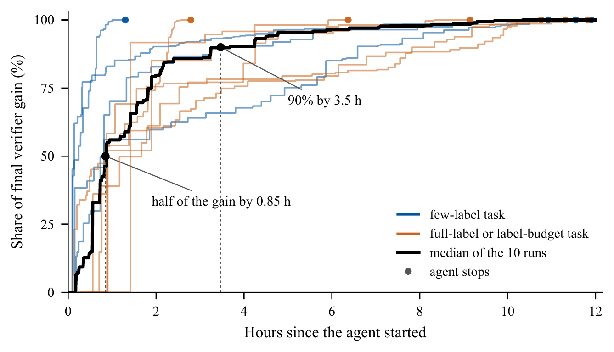

<div align="center">

# The Last Remote Sensing Model Built by Humans?<br>Casting *Any* Earth Observation Task as Recursive Self-Improvement

**[Sijie Zhao](https://scholar.google.com/citations?user=o-GZavgAAAAJ&hl=en)**<sup>1,2\*</sup> &nbsp;
**[Zeqi Zhou](https://scholar.google.com/citations?user=pqG03s0AAAAJ&hl=en)**<sup>1,2\*</sup> &nbsp;
**[Heli Qi](https://scholar.google.com/citations?user=CH-rTXsAAAAJ&hl=en)**<sup>2</sup> &nbsp;
**[Xuanchao Fu](https://scholar.google.com/citations?user=D0IIjfUAAAAJ&hl=en)**<sup>2</sup> &nbsp;
**[Zhuo Zheng](https://scholar.google.com/citations?user=CREpn_AAAAAJ&hl=en)**<sup>3</sup> &nbsp;
**[Junshi Xia](https://scholar.google.com/citations?user=n1aKdTkAAAAJ&hl=en)**<sup>2</sup> &nbsp;
**[Junjue Wang](https://scholar.google.com/citations?user=H58gKSAAAAAJ&hl=en)**<sup>1,2</sup><br>
**[Weihao Xuan](https://scholar.google.com/citations?user=7e0W-2AAAAJ&hl=en)**<sup>1,2†</sup> &nbsp;
**[Naoto Yokoya](https://scholar.google.com/citations?user=DJ2KOn8AAAAJ&hl=en)**<sup>1,2†</sup>

<sup>1</sup>The University of Tokyo &nbsp; <sup>2</sup>RIKEN &nbsp; <sup>3</sup>Stanford University

<sup>\*</sup>Equal contribution &nbsp; <sup>†</sup>Corresponding authors

[](https://arxiv.org/abs/2610.18845)


[](LICENSE)

</div>

> [!NOTE]
> **This is an ongoing project. The code is coming soon.**
> We are scaling up the experiments to a large number of EO tasks and agents and will update the paper with the results.

<p align="center">
  
</p>

<p align="center"><em>
RSI4EO casts any EO task as a harness and a verifier. (a) A general-purpose coding agent writes and trains the EO model and receives only the scores of the sealed verifier. (b) Each generation of the model is built from the outputs of the previous one, and the verifier decides which generation is kept.
</em></p>

## News

- **2026-10-13**: The first version of the paper is on [arXiv](https://arxiv.org/abs/2610.18845).

## Highlights

Earth observation (EO) models are still built by hand: for each new task, experts design a training recipe and tune it against a benchmark. We show that this loop can be handed to an agent.

- **A paradigm for building EO models.** Any verifiable task becomes a **harness**, which defines what the agent may use, and a **verifier**, which defines what counts as success. The many verification sources of EO (labeled benchmarks, independent sensors, physical models, repeated observation of the same place) become objectives that agents optimize directly, and learning settings become choices of these two components.
- **EO tasks across sensors and outputs.** The tasks of the paper cover optical, SAR, optical–SAR, multispectral time-series and hyperspectral imagery with pixel-level and instance-level outputs, and run in offline [Harbor](https://github.com/harbor-framework/harbor) containers.
- **Evidence across tasks, labels and agents.** Agent-built models surpass the state of the art on four benchmarks, keep 69 to 84% of that accuracy from 0.2 to 1.4% of the labels, and on OpenEarthMap beat every published full-label method from 11% of the labels.

## How it works

**Task = harness + verifier.** An EO task is a pair *T = (H, V)*.

- The **harness** *H* gives the agent what an EO researcher would start from: labeled training data, an unlabeled pool, pretrained encoders without task heads (DINOv3 ViT-L/16 pretrained on satellite imagery, DINOv2 ViT-L/14, ResNet-18 to ResNet-101, EfficientNet-B0), the Python deep-learning and geospatial stack, and a deliberately plain starter pipeline (EfficientNet-B0 + FPN). The agent has four GB200 GPUs and 12 hours in an offline container.
- The **verifier** *V* is sealed. It runs in a separate container that holds the validation data, executes a submitted pipeline exactly as the final grader will, and returns only the score. The agent never sees validation images or labels.
- When the budget ends, the agent's final pipeline is evaluated once on a hidden test set.

**Recursive improvement.** Each model the agent trains is a generation. Its outputs, such as pseudo-labels and class probabilities on the unlabeled pool, checkpoints and out-of-fold predictions, become the training material for the next generation, and the verifier decides which generation is kept. The agent designs this recursion itself; the task instruction permits such methods but prescribes none.

## Tasks

Five EO benchmarks that differ in sensor, output and metric. Each yields a full-label task and a few-label task. Benchmark names link to their original papers.

| Benchmark | Task | Input | Classes | Metric | Train | Verifier | Test | Few-label task |
|---|---|---|---:|---|---:|---:|---:|---|
| [OpenEarthMap](https://openaccess.thecvf.com/content/WACV2023/html/Xia_OpenEarthMap_A_Benchmark_Dataset_for_Global_High-Resolution_Land_Cover_Mapping_WACV_2023_paper.html) | land-cover mapping | RGB, 0.25–0.5 m | 8 | mIoU | 2,700 | 300 | 500 | 6 tiles, one per continent (0.2%) |
| [BRIGHT](https://doi.org/10.5194/essd-17-6217-2025) | building damage | optical + SAR pairs | 4 | mIoU | 2,918 | 450 | 878 | 14 pairs, one per event (0.5%) |
| [HRSID](https://doi.org/10.1109/ACCESS.2020.3005861) | ship instances | SAR, 0.5–3 m | 1 | mask AP | 3,090 | 552 | 1,962 | 36 images, one per scene (1.2%) |
| [PASTIS](https://doi.org/10.1109/ICCV48922.2021.00483) | crop-type mapping | Sentinel-2 time series | 19 | mIoU | 1,455 | 482 | 496 | 20 series, five per tile (1.4%) |
| [Toulouse](https://doi.org/10.1016/j.isprsjprs.2024.05.003) | surface materials | 310-band pixel spectra | 32 | macro-F1 | 190,969 | 39,991 | 149,272 | 160 pixels, five per class (0.1%) |

## Results

### One agent across five benchmarks

Hidden-test scores of the models built by Codex with GPT-6-Astra within 12 hours on four GB200 GPUs, against the starter pipeline of the harness and the best published method trained on all labels. "–" marks a score that is not available.

| Benchmark | Metric | Few labels<br>Starter | Few labels<br>RSI4EO | Full labels<br>Starter | Full labels<br>RSI4EO | Previous SOTA |
|---|---|---:|---:|---:|---:|---|
| OpenEarthMap | mIoU | 34.0 | **60.0** | – | **71.6** | 67.5 (PyramidMamba) |
| BRIGHT | mIoU | 34.8 | **49.4** | 61.8 | **71.6** | 68.9 (ensemble) |
| HRSID | mask AP | – | **50.2** | – | **68.7** | 63.9 (LFG-Net, GCIE-Net) |
| PASTIS | mIoU | 14.0 | **50.1** | 53.0 | **69.7** | 67.1 (Exchanger + Mask2Former) |
| Toulouse | macro-F1 | 50.3 | **69.1** | 66.2 | **71.8** | – |

OpenEarthMap reports 8-class mIoU on the official validation split, which serves as the test split because its test labels are withheld. The full comparison with published methods is in Table 2 of the paper.

### Labels and agents on OpenEarthMap

Hidden-test mIoU as the harness holds more labeled tiles. The 300 and 600 tiles are selected by k-center on frozen DINOv3 features, without labels.

| Labeled tiles | Share | Unlabeled tiles | Codex (GPT-6-Astra) | Claude Code (Claude Opus 5.5) |
|---:|---:|---:|---:|---:|
| 6 | 0.2% | 4,194 | 60.0 | 56.7 |
| 300 | 11% | 0 | 64.3 | 67.8 |
| 600 | 22% | 0 | 69.4 | 68.6 |
| 2,700 | 100% | 1,500 | 71.6 | 70.8 |
| *Previous SOTA, all labels* | | | 67.5 | 67.5 |

## Analysis

**The agent builds the recursion itself.** With six labeled OpenEarthMap tiles, the agent chooses an encoder with the verifier, pseudo-labels the 4,194 unlabeled tiles with its best model, and runs eight generations of self-training, each taught by the best pipeline the verifier has seen. The verifier score rises in every generation, from 56.7 to 61.9 mIoU. In the later generations, controller scripts written by the agent select the teacher from the verifier log and launch the next generation on their own. The few-label runs on BRIGHT and HRSID arrive at similar teacher–student loops, and no instruction asks for them.

<p align="center">
  
</p>

**Most of the gain arrives early.** Across the 10 GPT-6-Astra runs with recorded trajectories, half of the final verifier gain is reached after a median of 0.85 hours and 90% after 3.5 hours. The early steps are the choices experts otherwise make by hand: picking a pretrained encoder with the verifier, matching model capacity to the labels, debugging, and adding task-specific structure.

<p align="center">
  
</p>

**The verifier score carries over.** On OpenEarthMap the hidden-test score lies within about 2 points of the verifier score in all seven runs, and on PASTIS within 0.2 points. The remaining gaps mainly follow differences between the validation and test splits.

## License

This project is released under the [MIT License](LICENSE).

## Citation

If you find this work useful, please cite:

```bibtex
@article{zhao2026rsi4eo,
  title   = {The Last Remote Sensing Model Built by Humans? Casting Any Earth Observation Task as Recursive Self-Improvement},
  author  = {Zhao, Sijie and Zhou, Zeqi and Qi, Heli and Fu, Xuanchao and Zheng, Zhuo and Xia, Junshi and Wang, Junjue and Xuan, Weihao and Yokoya, Naoto},
  journal = {arXiv preprint arXiv:2610.18845},
  year    = {2026}
}
```

## Contact

For questions, please open an [issue](https://github.com/Yokoya-Lab-UTokyo/RSI4EO/issues) or contact the corresponding authors.
