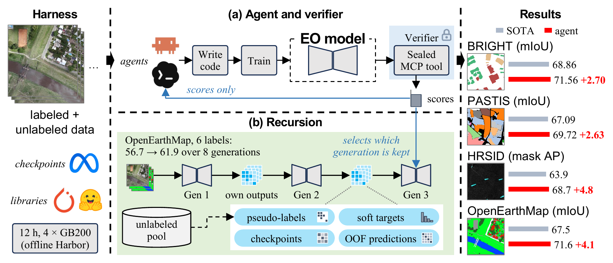
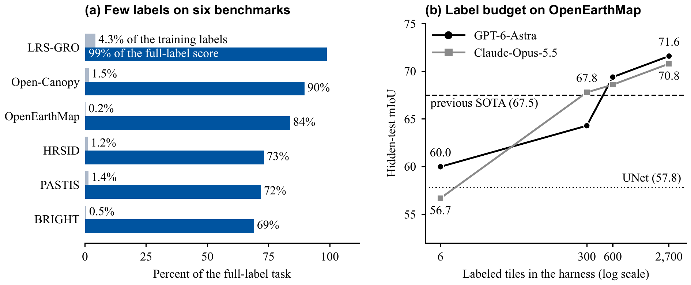
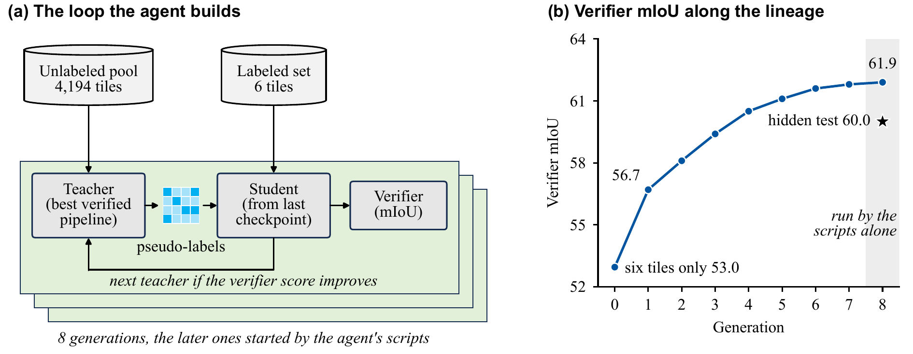
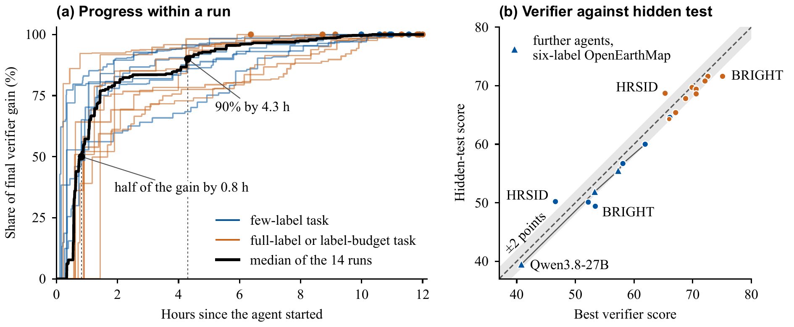

<div align="center">

# The Last Remote Sensing Model Built by Humans?<br>Casting *Any* Earth Observation Task as Recursive Self-Improvement

**[Sijie Zhao](https://scholar.google.com/citations?user=o-GZavgAAAAJ&hl=en)**<sup>1,2\*</sup> &nbsp;
**[Zeqi Zhou](https://scholar.google.com/citations?user=_fZaSDkAAAAJ)**<sup>1,2\*</sup> &nbsp;
**[Heli Qi](https://scholar.google.com/citations?user=CH-rTXsAAAAJ&hl=en)**<sup>2</sup> &nbsp;
**[Xuanchao Fu](https://scholar.google.com/citations?user=D0IIjfUAAAAJ&hl=en)**<sup>2</sup> &nbsp;
**[Zhuo Zheng](https://scholar.google.com/citations?user=CREpn_AAAAAJ&hl=en)**<sup>3</sup> &nbsp;
**[Junshi Xia](https://scholar.google.com/citations?user=n1aKdTkAAAAJ&hl=en)**<sup>2</sup> &nbsp;
**[Junjue Wang](https://scholar.google.com/citations?user=H58gKSAAAAAJ&hl=en)**<sup>1,2</sup><br>
**[Weihao Xuan](https://scholar.google.com/citations?user=7e0W-2AAAAJ&hl=en)**<sup>1,2†</sup> &nbsp;
**[Naoto Yokoya](https://scholar.google.com/citations?user=DJ2KOn8AAAAJ&hl=en)**<sup>1,2†</sup>

<sup>1</sup>The University of Tokyo &nbsp; <sup>2</sup>RIKEN &nbsp; <sup>3</sup>Stanford University

<sup>\*</sup>Equal contribution &nbsp; <sup>†</sup>Corresponding authors

[](https://arxiv.org/abs/2610.18845)


[](LICENSE)

</div>

> [!NOTE]
> **This is an ongoing project. The code is coming soon.**
> We are scaling up the experiments to a large number of EO tasks and agents and will update the paper with the results.

<p align="center">
  
</p>

<p align="center"><em>
RSI4EO casts any EO task as a harness and a verifier. The harness defines what the agent may use and the verifier defines what counts as success. (a) A general-purpose coding agent writes and trains the EO model and receives only the scores of the sealed verifier. (b) Each generation of the model is built from the outputs of the previous one, and the verifier decides which generation is kept. The resulting models surpass the state of the art on all six benchmarks.
</em></p>

## News

- **2026-10-13**: The first version of the paper is on [arXiv](https://arxiv.org/abs/2610.18845).

## Highlights

Earth observation (EO) models are still built by hand: for each new task, experts design a training recipe and tune it against a benchmark. We show that this loop can be handed to an agent.

- **A paradigm for building EO models.** Any verifiable task becomes a **harness**, which defines what the agent may use, and a **verifier**, which defines what counts as success. The many verification sources of EO (labeled benchmarks, independent sensors, physical models, repeated observation of the same place) become objectives that agents optimize directly, and learning settings become choices of these two components.
- **An open EO task suite.** We release the tasks of the paper as harness and verifier pairs that any agent can run in offline [Harbor](https://github.com/harbor-framework/harbor) containers. They cover optical, SAR, optical–SAR and multispectral time-series imagery as well as natural-language questions, with pixel-level, instance-level, continuous and textual outputs, and include a training-free task.
- **Evidence across tasks, labels and agents.** Agent-built models surpass the state of the art on all six benchmarks, on LRS-GRO without training any parameter and already from 114 answered questions. On OpenEarthMap, two agents with different working styles both surpass it, one of them from 11% of the labels. With the task fixed, stronger agents build stronger models, so EO models improve as agents do.

## How it works

**Task = harness + verifier.** An EO task is a pair *T = (H, V)*.

- The **harness** *H* gives the agent what an EO researcher would start from: labeled training data, an unlabeled pool where the task provides one, pretrained encoders without decoders or task heads (DINOv3 ViT-L/16 pretrained on satellite imagery, DINOv2 ViT-L/14, ResNet-18 to ResNet-101, EfficientNet-B0), the Python deep-learning and geospatial stack together with QGIS, SAGA and GDAL, and a deliberately plain starter pipeline (EfficientNet-B0 + FPN). Each task adds the standard tools of its field, such as detection libraries for HRSID and the Swin and VMamba backbones for BRIGHT. The question-answering task instead provides only the vision-language model Qwen3-VL-8B. The agent has four GB200 GPUs and 12 hours in an offline container, and no single training run may exceed 4 hours.
- The **verifier** *V* is sealed. It runs in a separate container that holds the validation data, executes a submitted pipeline exactly as the final grader will, and returns only scores: the task metric with its breakdown by class, object size, height range or question type, and the inference time. The agent never sees validation images or labels, and may query the verifier as often as it likes.
- When the agent stops or the budget ends, its final pipeline is evaluated once on a hidden test set. The submission must contain networks that the agent trained, except on the training-free task, where no parameter may be updated.

**Recursive improvement.** Each model the agent trains from the outputs of earlier models is a generation. Its outputs, such as pseudo-labels and class probabilities on the unlabeled pool, checkpoints and out-of-fold predictions, become the training material for the next generation, and the verifier decides which generation is kept. The agent designs this recursion itself; the task instruction permits such methods but prescribes none. Across the runs, the mechanisms work at the level of the data (teacher–student training on pseudo-labels), the parameters (starting from or averaging earlier checkpoints) and the predictions (models trained on the agent's own predictions).

**Learning settings as choices of harness and verifier.** Learning from few labels restricts the labeled data in the harness, training-free adaptation removes trainable parameters from it, a label-budget search asks for the smallest training set that passes a target score, and domain adaptation places the verifier on a target domain. The agent, the verifier interface and the final evaluation stay the same.

## Tasks

Six EO benchmarks that differ in sensor, output and metric. Each yields a full-label task and a few-label task. Benchmark names link to their original papers.

| Benchmark | Task | Input | Classes | Metric | Train | Verifier | Test | Few-label task |
|---|---|---|---:|---|---:|---:|---:|---|
| [OpenEarthMap](https://openaccess.thecvf.com/content/WACV2023/html/Xia_OpenEarthMap_A_Benchmark_Dataset_for_Global_High-Resolution_Land_Cover_Mapping_WACV_2023_paper.html) | land-cover mapping | RGB, 0.25–0.5 m | 8 | mIoU | 2,700 | 300 | 500 | 6 tiles, one per continent (0.2%) |
| [BRIGHT](https://doi.org/10.5194/essd-17-6217-2025) | building damage | optical + SAR pairs | 4 | mIoU | 2,918 | 450 | 878 | 14 pairs, one per event (0.5%) |
| [HRSID](https://doi.org/10.1109/ACCESS.2020.3005861) | ship instances | SAR, 0.5–3 m | 1 | mask AP | 3,090 | 552 | 1,962 | 36 images from 36 scenes (1.2%) |
| [PASTIS](https://doi.org/10.1109/ICCV48922.2021.00483) | crop-type mapping | Sentinel-2 time series | 19 | mIoU | 1,455 | 482 | 496 | 20 series, five per tile (1.4%) |
| [Open-Canopy](https://openaccess.thecvf.com/content/CVPR2025/html/Fogel_Open-Canopy_Towards_Very_High_Resolution_Forest_Monitoring_CVPR_2025_paper.html) | canopy height | SPOT 6–7 RGB + NIR, 1.5 m | – | MAE (m) | 66,339 | 7,369 | 13,675 | 1,000 tiles, spread over France (1.5%) |
| [LRS-GRO](https://openaccess.thecvf.com/content/CVPR2026/html/Liu_ZoomEarth_Active_Perception_for_Ultra-High-Resolution_Geospatial_Vision-Language_Tasks_CVPR_2026_paper.html) | large-image VQA, training-free | RGB, up to 27,328 px, + question | – | accuracy | 2,656 | 855 | 9,734 | 114 answers, six per question type (4.3%) |

BRIGHT and PASTIS count the background as a class. LRS-GRO counts questions and forbids any training, so its labels serve only as examples and for local validation. On OpenEarthMap, two further label-budget tasks hold the first 300 or 600 tiles ranked without labels by k-center on frozen DINOv3 features.

## Results

### One agent across six benchmarks

Hidden-test scores of the models built by Codex with GPT-6-Astra within 12 hours on four GB200 GPUs, against the starter pipeline of the harness and the best published result under each benchmark's standard protocol. Lower is better for the MAE of Open-Canopy. "–" marks a score that is not available.

| Benchmark | Metric | Few labels<br>Starter | Few labels<br>RSI4EO | Full labels<br>Starter | Full labels<br>RSI4EO | Previous SOTA |
|---|---|---:|---:|---:|---:|---|
| OpenEarthMap | mIoU | 34.0 | **60.0** | – | **71.6** | 67.5 (PyramidMamba) |
| BRIGHT | mIoU | 34.8 | **49.4** | 61.8 | **71.6** | 68.9 (ensemble) |
| HRSID | mask AP | – | **50.2** | – | **68.7** | 63.9 (LFG-Net, GCIE-Net) |
| PASTIS | mIoU | 14.0 | **50.1** | 53.0 | **69.7** | 67.1 (Exchanger + Mask2Former) |
| Open-Canopy | MAE (m) ↓ | – | **2.72** | 4.00 | **2.44** | 2.52 (PVTv2) |
| LRS-GRO (training-free) | accuracy | 58.0 | **64.6** | 58.0 | **65.4** | 61.0 (GazeEarth) |

With full labels, the margin over the previous state of the art is 4.8 mask AP on HRSID, 4.4 points of accuracy on LRS-GRO, 4.1 mIoU on OpenEarthMap, 2.7 mIoU on BRIGHT, 2.6 mIoU on PASTIS and 0.08 m of MAE on Open-Canopy. On LRS-GRO, the agent trains no parameter, yet its pipeline around the frozen Qwen3-VL-8B outperforms every published method, including models trained for large-image question answering. Each of these runs costs 100 to 170 US dollars of model usage and at most 48 GPU hours, where expert engineering takes weeks to months.

OpenEarthMap reports 8-class mIoU on the official validation split, which serves as the test split because its test labels are withheld. The full comparison with published methods is in the paper.

### Strong models from few labels

<p align="center">
  
</p>

<p align="center"><em>
(a) The share of the training labels that the few-label task of each benchmark keeps (grey) and its score as a share of the full-label score (blue). (b) Hidden-test mIoU on OpenEarthMap as the harness holds 6, 300, 600 or all 2,700 labeled tiles.
</em></p>

On LRS-GRO, 114 answered questions exceed every published method and reach 99% of the full-label accuracy. On OpenEarthMap, six labeled tiles (0.2%) yield 60.0 mIoU, above a UNet trained on the full training set (57.8). On Open-Canopy, 1,000 labeled tiles (1.5%) reach a lower error than Scale-MAE, DeepLabv3 and a CLIP-pretrained ViT-B trained on all 66,339 tiles. With 300 tiles (11%) and no unlabeled pool, Claude-Opus-5.5 already surpasses all 11 published methods on OpenEarthMap, each trained on 2,500 to 3,000 labeled tiles; from 600 tiles (22%), both agents do. Most of the value of the training labels lies in the first few hundred tiles.

| Labeled tiles | Share | Unlabeled tiles | GPT-6-Astra | Claude-Opus-5.5 |
|---:|---:|---:|---:|---:|
| 6 | 0.2% | 4,194 | **60.0** | 56.7 |
| 300 | 11% | 0 | 64.3 | **67.8** |
| 600 | 22% | 0 | **69.4** | 68.6 |
| 2,700 | 100% | 1,500 | **71.6** | 70.8 |
| *Previous SOTA, all labels* | | | 67.5 | 67.5 |

### Stronger agents build stronger models

Five agents on six-label OpenEarthMap, each given the same harness, verifier and 12-hour budget. The verifier column gives the best verifier score of each run.

| Agent | Interface | Verifier | Test mIoU |
|---|---|---:|---:|
| Starter pipeline | – | – | 34.0 |
| Qwen3.8-27B | Claude Code | 40.8 | 39.5 |
| Qwen3.8-Max | Claude Code | 53.3 | 51.9 |
| Kimi-K3 | Claude Code | 57.3 | 55.5 |
| Claude-Opus-5.5 | Claude Code | 58.1 | 56.7 |
| GPT-6-Astra | Codex | 61.9 | **60.0** |

Every agent raises the starter, by up to 26.0 mIoU. The four strongest arrive independently at the same recipe: a pretrained ViT-L encoder with a decoder of their own, self-training on the unlabeled pool and multi-scale test-time augmentation. Since only the agent changes, the EO model improves directly with the agent that builds it, and every advance in agents turns into better EO models without new human engineering.

The two strongest agents work in different styles. With six tiles, GPT-6-Astra submits 342 pipelines to the verifier along a deep self-training lineage, whereas Claude-Opus-5.5 submits 43 in fewer and larger steps. GPT-6-Astra leads with six tiles and Claude-Opus-5.5 with 300 tiles, and from 600 tiles upward, their scores lie within one point of each other.

## Analysis

**The agent builds the recursion itself.** With six labeled OpenEarthMap tiles, GPT-6-Astra chooses an encoder with the verifier, pseudo-labels the 4,194 unlabeled tiles with its best model, and runs eight generations of self-training, each taught by the best pipeline the verifier has seen. The verifier score rises in every generation, from 56.7 to 61.9 mIoU, well above the 53.0 of the best model trained on the six tiles alone. In the later generations, controller scripts written by the agent select the teacher from the verifier log and launch the next generation on their own, so the recursion extends from the model to the procedure that improves it. The few-label runs on BRIGHT, HRSID and Open-Canopy arrive at similar teacher–student loops, and no instruction asks for them.

<p align="center">
  
</p>

**Most of the gain arrives early.** Across 14 runs of GPT-6-Astra on the six benchmarks, half of the final verifier gain is reached after a median of 0.8 hours and 90% after 4.3 hours. The early steps are the choices experts otherwise make by hand: picking a pretrained encoder with the verifier, matching training to the labels, debugging, and adding task-specific structure. On Open-Canopy, for example, the agent finds that the default image reader treats the near-infrared band as an alpha channel, and infers that the direction of shadows carries height information, so it trains without rotations and flips.

**The verifier score carries over.** Across the five agents on six-label OpenEarthMap, the verifier ranks the models exactly as the hidden test does. The hidden-test score lies within 2.0 points of the verifier score in every run on OpenEarthMap and LRS-GRO, within 0.2 points on full-label PASTIS and within 0.07 m on Open-Canopy, and on HRSID it is even higher.

<p align="center">
  
</p>

<p align="center"><em>
(a) Share of the final verifier gain reached over time in the 14 runs of GPT-6-Astra. (b) Hidden-test score against best verifier score; the grey band marks a difference of at most 2 points.
</em></p>

## License

This project is released under the [MIT License](LICENSE).

## Citation

If you find this work useful, please cite:

```bibtex
@article{zhao2026rsi4eo,
  title   = {The Last Remote Sensing Model Built by Humans? Casting Any Earth Observation Task as Recursive Self-Improvement},
  author  = {Zhao, Sijie and Zhou, Zeqi and Qi, Heli and Fu, Xuanchao and Zheng, Zhuo and Xia, Junshi and Wang, Junjue and Xuan, Weihao and Yokoya, Naoto},
  journal = {arXiv preprint arXiv:2610.18845},
  year    = {2026}
}
```

## Contact

For questions, please open an [issue](https://github.com/Yokoya-Lab-UTokyo/RSI4EO/issues) or contact the corresponding authors.
